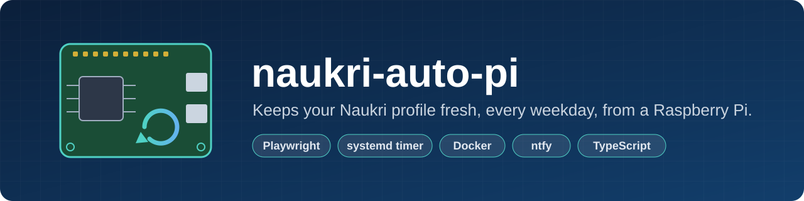
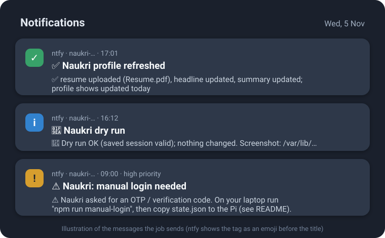

<p align="center">
  
</p>

<p align="center">
  
  
  
  
  
</p>

# naukri-refresher

A small Playwright (Chromium) job for a Raspberry Pi on your home network. On a systemd timer
(for example 09:00, 13:00 and 17:00 on weekdays) it keeps **your own** Naukri.com profile fresh:

1. reuses the saved session (or logs in with your stored credentials),
2. re-uploads your resume,
3. optionally re-saves your resume headline and profile summary from `config.json`,
4. reloads the profile and checks that it shows today as the last update,
5. sends you the result on ntfy or Telegram, and optionally pings healthchecks.io.

Optionally, a second job [auto-applies](#auto-apply-optional) to matching jobs, answering screening
questions from your saved answers and a small language model that runs on the Pi itself.

## Quick start

```bash
# laptop (Git Bash on Windows): copy the repo to the Pi and run the installer there
PI=user@your-pi bash scripts/deploy.sh

# Pi: resume, config and encrypted credentials
sudo cp ~/Resume.pdf /etc/naukri-refresher/resume/resume.pdf
sudoedit /etc/naukri-refresher/config.json
sudo bash /opt/naukri-refresher/scripts/set-credentials.sh

# laptop: log in once yourself, then copy state.json to the Pi (setup steps 4-5)
npm ci && npx playwright install chromium && npm run manual-login

# Pi: test, then switch on the timer
bash /opt/naukri-refresher/scripts/run-now.sh --dry-run
sudo systemctl enable --now naukri-refresher.timer
```
Full details are in [Setup (in this order)](#setup-in-this-order).

It has no web UI, no listening ports, and uses no cloud services beyond the notifications.
It does not solve OTPs or CAPTCHAs, use stealth plugins, randomise timing or use proxies. When
Naukri wants a human, the job stops and asks you (exit code 2).

> Automating a website can conflict with its terms of use. This tool touches only your own
> account, once a day, at a fixed time, but the account risk is yours to judge.

| Exit code | Meaning | Retried? |
|---|---|---|
| 0 | Success | - |
| 1 | Failure at some step (screenshot + trace saved) | Once, after `retryDelaySeconds` |
| 2 | Manual login needed (OTP, CAPTCHA, rejected password, no session or credentials) | Never |

---

## Contents

- [How it works](#how-it-works)
- [Pi prerequisites](#pi-prerequisites)
- [Setup (in this order)](#setup-in-this-order)
- [Configuration](#configuration)
- [Auto-apply (optional)](#auto-apply-optional)
- [Daily operation](#daily-operation)
- [Updating the resume, headline or schedule](#updating-the-resume-headline-or-schedule)
- [Recovering from exit code 2](#recovering-from-exit-code-2)
- [Refreshing selectors when Naukri changes](#refreshing-selectors-when-naukri-changes)
- [Reading logs](#reading-logs)
- [Security model](#security-model)
- [Native mode (fallback)](#native-mode-fallback)
- [Development and tests](#development-and-tests)
- [Uninstalling](#uninstalling)

---

## How it works

```
systemd timer (config "schedule", e.g. Mon..Fri 09,13,17:00; Persistent=true)
  └─ naukri-refresher.service  (oneshot)
       ├─ LoadCredentialEncrypted=  -> decrypted into $CREDENTIALS_DIRECTORY (RAM)
       └─ Docker mode: scripts/docker-run.sh -> hardened container, runs as UID "naukri"
          Native mode: xvfb-run node dist/index.js as user "naukri"
               ├─ config.json validated (zod), resume checked (type, ≤ 2 MB)
               ├─ lock file, daily cap (maxAttemptsPerDay, default 2)
               ├─ attempt 1 ─ fail(1) ─ wait 60 s ─ attempt 2   (exit 2 is never retried)
               ├─ state.json (session) reused and saved, mode 600
               ├─ on failure: screenshot + trace -> artifacts/ (newest 10 kept)
               └─ ntfy / Telegram + healthchecks.io start/success/fail
```

| Path on the Pi | Contents | Owner / mode |
|---|---|---|
| `/opt/naukri-refresher/` | the app (copied by `install.sh`) | root, read-only |
| `/etc/naukri-refresher/config.json` | non-secret settings | root:naukri 640 |
| `/etc/naukri-refresher/resume/` | your resume file | root:naukri 750 / 640 |
| `/etc/naukri-refresher/creds/*.cred` | encrypted credentials | root 700 / 600 |
| `/var/lib/naukri-refresher/state.json` | Playwright session (cookies) | naukri 600 |
| `/var/lib/naukri-refresher/artifacts/` | failure screenshots and traces, dry-run screenshots | naukri 700 |
| `/var/lib/naukri-refresher/last-run.json`, `attempts.json` | last result, daily attempt counter | naukri 600 |

**Retry choice:** the app retries itself once, not via systemd `Restart=on-failure`. It behaves
the same in Docker and native mode, is unit-tested, and never retries exit code 2. A small
`attempts.json` counter caps real attempts per calendar day (`maxAttemptsPerDay`), whether they come from the
timer, a catch-up run after a power cut, or `run-now.sh`. Dry runs don't count.

**Playwright version:** `playwright@1.64.1` is pinned exactly. The Docker base image
`mcr.microsoft.com/playwright:v1.64.1-noble` is multi-arch (`linux/amd64`, `linux/arm64`;
checked on 2026-11-05). To upgrade, change **both** `package.json` and the `Dockerfile` tag to
the same version.

---

## Pi prerequisites

- Raspberry Pi 4 or 5, 4 GB+ RAM, **64-bit** Raspberry Pi OS (Bookworm or Trixie):
  ```bash
  uname -m        # must print: aarch64   (armv7l = 32-bit OS - reinstall with the 64-bit image)
  ```
- Timezone and clock:
  ```bash
  sudo timedatectl set-timezone Asia/Kolkata
  timedatectl     # "System clock synchronized: yes"
  ```
  A Pi 4 has no real-time clock. `install.sh` enables `systemd-time-wait-sync`, so the timer
  (and a catch-up run after a power cut) waits until NTP has set the clock.
- SSH with key-based auth only. No port forwarding on your router; the job only makes
  outgoing connections.
- **Docker** (default mode): install Docker Engine for Debian (see the
  [Docker docs](https://docs.docker.com/engine/install/debian/)). Don't add any user to the
  `docker` group for this; the service runs `docker` as root.
- `python3` and `systemd-creds` (both included in Raspberry Pi OS Bookworm and Trixie).

On a laptop (for `manual-login` and `deploy.sh`) you need Node 20+ and Git. On Windows, use Git
Bash for the `.sh` scripts.

---

## Setup (in this order)

### 1. Install on the Pi

From your laptop (copies the repo to `~/naukri-auto-pi` on the Pi and runs `install.sh`):
```bash
PI=pi@raspberrypi.local bash scripts/deploy.sh
```
or directly on the Pi:
```bash
git clone https://github.com/sdhanush13/naukri-auto-pi.git && cd naukri-auto-pi
sudo bash scripts/install.sh            # add --mode native for the fallback
```
`install.sh` does the following, and is safe to re-run:
- creates the system user `naukri` (no login shell) and the directories above,
- copies the app to `/opt/naukri-refresher`,
- builds the Docker image (or installs Node deps + Chromium in native mode),
- installs the service and timer, and applies the schedule from `config.json`.

It does **not** enable the timer on first install; you do that after a successful dry run.

### 2. Configure

```bash
sudo cp ~/Resume.pdf /etc/naukri-refresher/resume/resume.pdf
sudo chown root:naukri /etc/naukri-refresher/resume/resume.pdf
sudo chmod 640 /etc/naukri-refresher/resume/resume.pdf
sudoedit /etc/naukri-refresher/config.json      # see "Configuration"
```

### 3. Store credentials (encrypted)

```bash
sudo bash /opt/naukri-refresher/scripts/set-credentials.sh            # username + password
sudo bash /opt/naukri-refresher/scripts/set-credentials.sh telegram   # only if using Telegram
```
The password is typed into a hidden prompt and piped straight into `systemd-creds encrypt`.
It is never printed, logged, put in an env var or written in plain text.

### 4. Create a session on your laptop: `manual-login`

The Pi logs in by itself when needed. A first session made by you avoids an OTP on the first run.
```bash
npm ci
npx playwright install chromium
npm run manual-login           # opens a normal Chromium window
```
Log in yourself and complete any OTP. The script notices when your Naukri home page opens
(add `-- --enter` to confirm with Enter instead), checks your profile page and writes
`state.json`.

### 5. Copy the session to the Pi

```bash
scp state.json pi@raspberrypi.local:/tmp/naukri-state.json
ssh pi@raspberrypi.local 'sudo install -m 600 -o naukri -g naukri /tmp/naukri-state.json /var/lib/naukri-refresher/state.json && rm /tmp/naukri-state.json'
rm state.json                  # it is as sensitive as your password
```
(On Windows PowerShell, use `Remove-Item state.json` for the last line.)

Optional, before deleting it: to copy your current headline and summary into `config.json`,
run `npx tsx scripts/read-profile-text.ts` on the laptop. It uses `state.json`, opens each
editor only to read it (Cancel, never Save), and writes `profile-text.json`.

### 6. Dry run

```bash
bash /opt/naukri-refresher/scripts/run-now.sh --dry-run
```
This restores the session (or logs in), takes a screenshot of your profile into
`artifacts/<time>-dry-run/profile.png`, and changes nothing. You should get a 🧪 notification.

### 7. Enable the timer

```bash
sudo systemctl enable --now naukri-refresher.timer
bash /opt/naukri-refresher/scripts/status.sh      # shows the next run
```
(`sudo bash scripts/install.sh --enable` does the same.)

---

## Configuration

`/etc/naukri-refresher/config.json` holds non-secret settings only. Unknown keys are rejected,
so typos don't pass silently.

```json
{
  "resumePath": "/etc/naukri-refresher/resume/resume.pdf",
  "headline": "Software engineer - TypeScript, Node.js, cloud. Open to new roles.",
  "summary": "At least 50 characters ... (omit the key to leave your summary untouched)",
  "schedule": "Mon..Fri 10:00",
  "notify": { "provider": "ntfy", "server": "https://ntfy.sh", "topic": "naukri-long-random-string" },
  "healthchecksUrl": "https://hc-ping.com/your-check-uuid",
  "retryDelaySeconds": 60
}
```

| Key | Rule |
|---|---|
| `resumePath` | `.pdf` / `.doc` / `.docx`, at most 2 MB; the file signature is checked too. Keep it under `/etc/naukri-refresher/resume/` (Docker mounts only that tree). |
| `headline` | optional, at most 250 chars and at least 5 words (Naukri's rules). Omit to leave it untouched. |
| `summary` | optional, 50-1000 chars. Omit to leave it untouched. Each run re-saves the same text. |
| `schedule` | systemd `OnCalendar` expression, local time. Default `Mon..Fri 10:00`. |
| `notify` | `{"provider":"ntfy","topic":...,"server"?}`, `{"provider":"telegram","chatId":...}` or `{"provider":"none"}` |
| `healthchecksUrl` | optional; pinged with `/start`, success and `/fail`. Set the check's period to match your schedule (for example, cron `0 10 * * 1-5`, IST, grace 1 h). |
| `retryDelaySeconds` | 0-900, default 60 |
| `maxAttemptsPerDay` | 1-6, default 2. A hard cap on real attempts per day, counting all runs and retries. For N scheduled runs use N + 1, for example `"schedule": "Mon..Fri 09,13,17:00"` with `4`. More runs a day look more automated to Naukri and Akamai. |
| `browserMode` | `"headless"` (default) or `"headed"`. See [Browser mode](#browser-mode). |
| `timeouts` | optional `{navigationMs, actionMs, uploadMs}`; defaults 45 s / 20 s / 90 s (the Pi is slower than a laptop) |

### Browser mode

On 2026-11-05 the first dry run from the Pi got **"Access Denied"** from Naukri's CDN bot
protection (Akamai, `errors.edgesuite.net`). This happened before any login, so it wasn't the
account or the session. Akamai refuses headless Chromium.

`"browserMode": "headed"` runs a normal, visible Chromium on a virtual X display (Xvfb, via
`xvfb-run` in the Docker entrypoint and the native unit). It's the same unmodified Playwright
Chromium, with no stealth plugins, no user-agent or fingerprint changes and no proxies. But its
purpose is to get past a block that Naukri deliberately set up, which goes against the original
"no anti-detection" rule and very likely Naukri's terms. The account owner chose to accept
that knowingly. Things to keep in mind:
- Akamai can tighten its checks at any time. Then runs fail at step `session` with the same
  "Access Denied" screenshot. Don't escalate further (stealth plugins, spoofing, proxies); fall
  back to a weekday reminder and a manual upload.
- If Naukri flags the account as automated, stop the timer
  (`sudo systemctl disable --now naukri-refresher.timer`).
- Headed mode uses more memory (about 100-200 MB extra) than headless.

**Notifications**

<p align="center">
  
</p>

An illustration of what arrives on your phone. The titles and texts are the real ones from
`src/notify.ts`; the first is the message from an actual run. Failures (❌ "Naukri refresh
failed") name the failed step and where its screenshot is, and come at high priority like
the manual-login one.

- **ntfy**: anyone who knows a public ntfy.sh topic can read it, so use a long random topic
  name. Subscribe in the ntfy app. For a protected topic or a self-hosted server with auth,
  store the token with `set-credentials.sh ntfy`.
- **Telegram**: create a bot with @BotFather, store its token with
  `set-credentials.sh telegram`, and put your chat id in `notify.chatId`.

---

## Auto-apply (optional)

A second, separate job (`naukri-apply.service` + `naukri-apply.timer`, Docker mode only). It
searches Naukri with your keywords, filters the results, and applies through Naukri's own
Apply button, answering the recruiter's screening questions from **your** saved answers.

```
naukri-apply.timer (apply.schedule, e.g. Mon..Fri 11:00)
  └─ naukri-apply.service ─ same image/hardening, --task apply, network naukri-net
       ├─ each search: first results page only (/<keywords>-jobs-in-<city>?experience=&jobAge=[&wfhType=2])
       ├─ filter: title words, companies, experience range, already seen (apply-history.json)
       ├─ job page: "Apply on company site" / walk-in → never followed; "Applied" → skipped
       ├─ Apply → screening chatbot: each question answered by
       │     1. a saved rule (answers.json "rules"), 2. per-skill years ("skills"),
       │     3. the local model (Ollama, on the Pi) using only your "profile" text
       │   personal questions (CTC, notice, DOB, ID numbers…) never go to the model;
       │   no answer → the job is skipped and the question is listed in the notification
       └─ ntfy: what it applied to (or would, in a dry run) and which questions to add
```

**Safety rails**
- `mode: "dry-run"` (default) applies to nothing. `mode: "auto"` with `autoFrom` stays a dry run
  until that date, so you can watch a week of reports first.
- `maxPerDay` (default 10, max 25) is a hard cap; it also stops on Naukri's "daily quota" message,
  and after 3 jobs in a row fail (probably changed selectors).
- A fixed pause (`pauseSeconds`, default 8) between pages; only the first results page per search.
- Each job is applied to once. A job skipped for a missing answer is retried only after
  `answers.json` changes.
- The local model runs in the `naukri-ollama` container with no published port; nothing about
  you or the jobs leaves the Pi except the application itself.

**Risk:** auto-applying is more automation than refreshing a profile, and Naukri's bot
protection already blocks headless browsers. Applications go out in your name; check the
dry-run reports and the first real day closely. The same stop rule applies: if Naukri starts
challenging or restricting the account, turn it off (`"mode": "off"`, then `install.sh`).

**Setup**
1. Add an `apply` section to `config.json`:
   ```json
   "apply": {
     "mode": "auto",
     "autoFrom": "2026-11-18",
     "schedule": "Mon..Fri 11:00",
     "searches": [
       { "keywords": "senior .net developer", "location": "bangalore" },
       { "keywords": "senior .net developer", "remote": true }
     ],
     "experienceYears": 5,
     "jobAgeDays": 3,
     "maxPerDay": 10,
     "requireTitleWords": [".net", "dotnet", "c#"],
     "excludeTitleWords": ["intern", "trainee"],
     "llm": { "model": "qwen2.5:3b" }
   }
   ```
   Leave out `llm` to skip every job that asks something without a saved answer.
2. Create `/etc/naukri-refresher/answers.json` from [`answers.example.json`](answers.example.json)
   (`profile`, `rules`, `skills`). Fill in CTC and anything else only you can answer.
   Optional `"dateOfBirth": "YYYY-MM-DD"` answers age questions with your age on the day.
   Rules match when all their words appear in the question; the first match wins, so put
   specific rules (`current ctc lakhs`) before general ones (`current ctc`).
3. `sudo bash /opt/naukri-refresher/scripts/install.sh`. It installs the apply units, starts
   Ollama and downloads the model (about 2 GB), and enables the apply timer.
4. Check what it would answer, without a browser:
   ```bash
   sudo docker run --rm --init --user "$(id -u naukri):$(id -g naukri)" --network naukri-net \
     -v /etc/naukri-refresher:/etc/naukri-refresher:ro --entrypoint node \
     naukri-refresher:latest /app/dist/index.js --task rehearse
   ```
5. Try it: `bash /opt/naukri-refresher/scripts/run-now.sh --apply --dry-run`.

On a Pi 4 the first model answer of a run takes about 3-4 minutes (the model loads and reads
your profile); later answers take 10-30 seconds. Saved answers are instant.

---

## Daily operation

| Task | Command (on the Pi) |
|---|---|
| Run now and follow the log | `bash /opt/naukri-refresher/scripts/run-now.sh` |
| Dry run | `bash /opt/naukri-refresher/scripts/run-now.sh --dry-run` |
| Last result, next run, newest artifacts | `bash /opt/naukri-refresher/scripts/status.sh` |
| Auto-apply now (dry run / real) | `bash /opt/naukri-refresher/scripts/run-now.sh --apply --dry-run` / `--apply` |
| Deploy a code change from the laptop | `PI=pi@raspberrypi.local bash scripts/deploy.sh` |

A real `run-now.sh` counts toward the daily cap (`maxAttemptsPerDay`). If scheduled runs already used it up,
the run stops with step `daily-cap`.

---

## Updating the resume, headline or schedule

- **Resume:** copy the new file to `/etc/naukri-refresher/resume/` (owner `root:naukri`,
  mode 640). If the filename changed, update `resumePath`. Naukri shows the uploaded filename,
  so pick a sensible one. Run a dry run, or just wait for the next scheduled run.
- **Headline / summary:** edit `config.json`. The next run applies it.
- **Schedule:** edit `schedule` in `config.json`, then re-apply it with
  `sudo bash /opt/naukri-refresher/scripts/install.sh`.
  Check the expression with `systemd-analyze calendar "Mon..Fri 10:00"`.

---

## Recovering from exit code 2

Exit code 2 means a human is needed. You get a "manual login needed" notification, and there
is a screenshot in `/var/lib/naukri-refresher/artifacts/<time>-manual-login/`.

1. Look at the reason in the notification or in `status.sh`:
   - *OTP / verification / CAPTCHA*: Naukri wants to verify you.
   - *rejected the username/password*: re-run `set-credentials.sh`, then do step 2.
   - *no Naukri credentials*: run `set-credentials.sh`.
2. On your laptop, run `npm run manual-login`, log in yourself, and complete the OTP.
3. Copy `state.json` to the Pi (setup step 5).
4. Run `run-now.sh --dry-run` to confirm. The timer resumes normally.

The job never retries exit code 2 automatically, so it won't trigger repeated OTP messages or
lock your account with repeated wrong passwords.

Sessions saved on a laptop can be invalidated sooner because the Pi's Chromium reports a
different browser. If you hit exit 2 often, let the Pi log in with stored
credentials, and use `manual-login` only when Naukri asks for an OTP.

---

## Refreshing selectors when Naukri changes

All selectors are in [`src/selectors.ts`](src/selectors.ts). They use `getByRole` /
`getByPlaceholder` / `getByText` first, with CSS ids as fallbacks.

The selectors were cross-checked against several public Naukri automation projects and then
confirmed on the live site on 2026-11-05: upload, headline, summary (`#profileSummaryTxt`) and
the "last updated" check. The lower profile sections are lazy-loaded, so the job scrolls to
each one before editing it. Sources and observed quirks are listed at the top of
`selectors.ts`. If a step fails, or whenever Naukri changes its layout:

1. Find the failing step (notification, `status.sh`). Copy the artifacts to your laptop:
   ```bash
   ssh pi@raspberrypi.local 'sudo tar -C /var/lib/naukri-refresher/artifacts -cf - .' > artifacts.tar
   npx playwright show-trace <run>/trace.zip       # step-by-step DOM snapshots
   ```
   Traces and screenshots contain session cookies and personal data. Don't share them, and
   delete them when you're done.
2. On the laptop, explore the live page:
   ```bash
   npx playwright codegen https://www.naukri.com
   ```
   Log in, open your profile, and use the "pick locator" tool on the resume upload button,
   the headline/summary pencil icons, their text boxes, the Save button, the upload success
   message and the "Profile last updated" text.
3. Update `src/selectors.ts`, then update `tests/mock-site/pages/*.html` to match so the tests
   still describe the real site. Run `npm test`, then `deploy.sh` and a dry run.

---

## Reading logs

Logs go to journald as JSON lines; there are no log files on the SD card.
```bash
journalctl -u naukri-refresher.service -n 100 --no-pager -o cat      # last run
journalctl -u naukri-refresher.service --since today -o cat
journalctl -u naukri-refresher.service -f -o cat                     # live
journalctl -u naukri-refresher.timer                                 # when it fired
```
To keep journald from wearing the SD card, consider `Storage=volatile` or a
`SystemMaxUse=50M` limit in `/etc/systemd/journald.conf`.

---

## Security model

**Credentials**
- Stored only as `systemd-creds` ciphertext in `/etc/naukri-refresher/creds/` and decrypted
  by systemd into a private in-memory `$CREDENTIALS_DIRECTORY` for the duration of a run.
- **The Pi has no TPM**, so systemd encrypts with a host key
  (`/var/lib/systemd/credential.secret`). That protects against casual file reads, backups and
  copies of `/etc`. It does **not** protect against root on the Pi, who can decrypt.
- Docker mode: `docker-run.sh` copies the decrypted files into the unit's private
  RuntimeDirectory (tmpfs, deleted when the run ends), owned by `naukri`, and mounts them
  read-only at `/run/creds`. They never go into env vars, the image or `.env` files.
- Tracing starts only **after** login, so traces never record the password being typed. (A test
  checks this.)
- `state.json` and traces hold live session cookies. They are mode 600/700 and owned by
  `naukri`; treat them like a password.

**Service hardening**
- Docker mode (default): `docker` talks to a root-equivalent socket, so the unit runs as root
  and does nothing except launch the container. The real isolation is the container:
  - runs as the unprivileged `naukri` UID, `--read-only` root filesystem, `--cap-drop=ALL`,
    `no-new-privileges`, `--memory=1536m`, `--pids-limit=512`, `--shm-size=512m`, tmpfs `/tmp`,
  - only `/var/lib/naukri-refresher` is writable; `/etc/naukri-refresher` is read-only.
  - Chromium runs with `--no-sandbox` here, because seccomp + cap-drop block its user-namespace
    sandbox. The container is the sandbox.
  - The unit's own hardening (`ProtectSystem=strict`, `ProtectHome`, `NoNewPrivileges`,
    `RestrictAddressFamilies=AF_UNIX`, capabilities limited to `CAP_CHOWN CAP_FOWNER` for the
    credential copy) confines only the wrapper script.
  - Raspberry Pi OS may have the memory cgroup disabled. If `docker run` warns that
    `--memory` is ignored, add `cgroup_enable=memory cgroup_memory=1` to
    `/boot/firmware/cmdline.txt` and reboot.
- Native mode: `User=naukri`, `NoNewPrivileges`, `ProtectSystem=strict`, `ProtectHome=yes`,
  `PrivateTmp`, `PrivateDevices`, `ReadWritePaths=/var/lib/naukri-refresher`, an empty
  `CapabilityBoundingSet=`, `MemoryMax=1536M` and more. These are the relaxations Chromium
  genuinely needs (also commented in the unit):
  1. `RestrictAddressFamilies` adds **`AF_NETLINK`**: Chromium's network-change notifier.
  2. **No `RestrictNamespaces=`**: Chromium's own sandbox uses user/PID/net namespaces. Keeping
     that sandbox beats `--no-sandbox`.
  3. **No `MemoryDenyWriteExecute=`**: V8's JIT needs W+X memory.
  4. **No `SystemCallFilter=`**: Chromium applies its own seccomp-bpf filter.
- No listening ports, no web UI, no inbound connections, no router port forwarding.

---

## Native mode (fallback)

Use native mode if Docker isn't wanted or available.
```bash
# Node 22 LTS for root/system, e.g. NodeSource:
curl -fsSL https://deb.nodesource.com/setup_22.x -o /tmp/nodesource.sh && sudo bash /tmp/nodesource.sh
sudo apt-get install -y nodejs
sudo bash scripts/install.sh --mode native
```
`install.sh` then runs `npm ci`, builds, and runs
`npx playwright install --with-deps chromium` into `/opt/naukri-refresher/ms-playwright`. It
stops with a clear message if Playwright can't provide arm64 Chromium for the OS. The mode is
remembered, so later `deploy.sh` runs keep using native.

To switch modes, re-run `install.sh --mode docker` or `--mode native`.

---

## Development and tests

```bash
npm ci
npx playwright install chromium
npm test            # unit + flow tests
npm run typecheck
npm run build
```
- `tests/unit/`: config validation (headline ≤ 250, summary ≥ 50, resume type/size/signature),
  exit-code and retry logic (one retry, never on exit 2 or dry run, daily cap), lock file,
  artifact pruning.
- `tests/flow/`: runs the real flow in headless Chromium against `tests/mock-site/`, a local
  imitation of the Naukri login, OTP, CAPTCHA, upload and profile-edit pages. It covers
  success, session reuse, OTP → exit 2, CAPTCHA → exit 2, rejected password → exit 2, missing
  credentials → exit 2, upload failure → exit 1 with screenshot and trace, and dry run.
  Nothing touches naukri.com.

To run the built CLI locally against your own config:
`node dist/index.js --config ./my-config.json --dry-run`. Credentials come from files in the
directory named by `CREDENTIALS_DIRECTORY`.

---

## Uninstalling

```bash
sudo systemctl disable --now naukri-refresher.timer
sudo systemctl stop naukri-refresher.service
sudo rm -rf /etc/systemd/system/naukri-refresher.service /etc/systemd/system/naukri-refresher.service.d \
            /etc/systemd/system/naukri-refresher.timer /etc/systemd/system/naukri-refresher.timer.d
sudo systemctl daemon-reload
sudo docker image rm naukri-refresher:latest 2>/dev/null || true
sudo rm -rf /opt/naukri-refresher /var/lib/naukri-refresher /etc/naukri-refresher   # config, creds, resume, session
sudo userdel naukri
```
Also delete the ntfy topic subscription, the Telegram bot and the healthchecks.io check if
you no longer need them.
